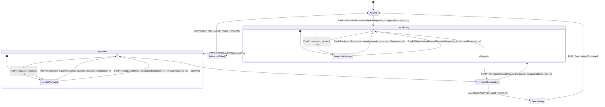
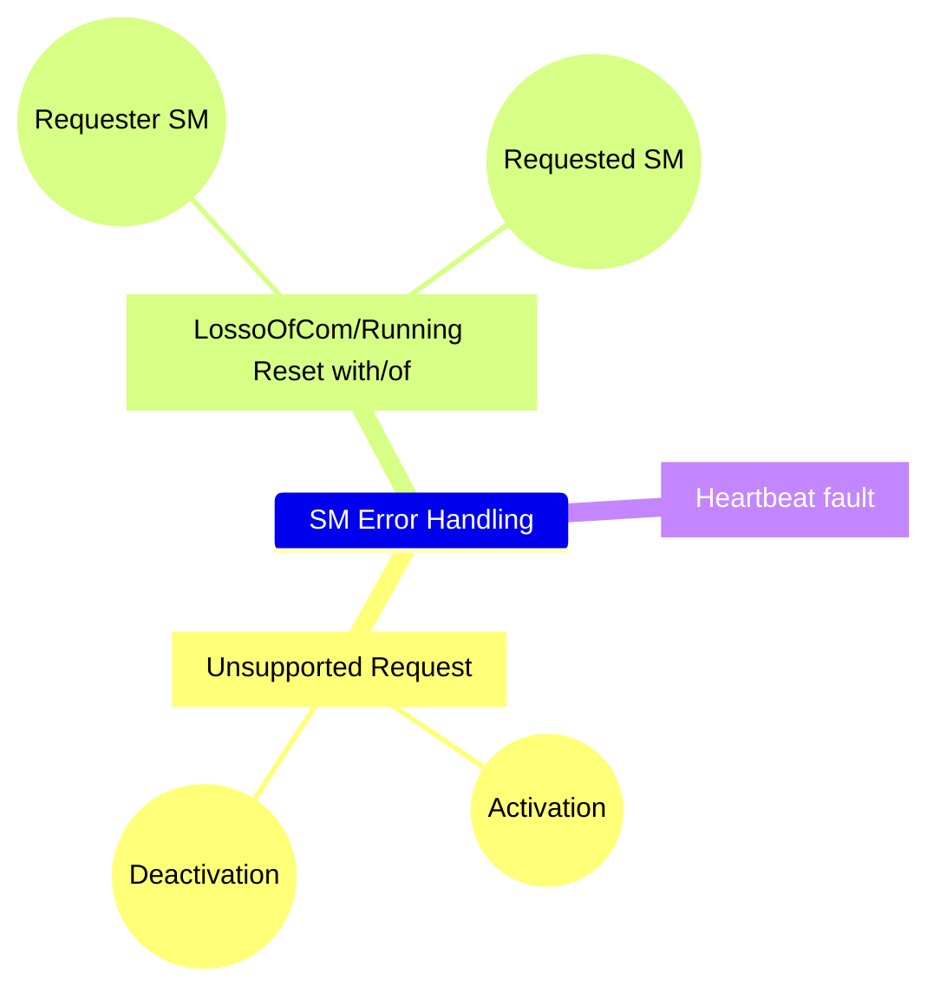

# SPM features

<table border="1">
    <tr border="1">
        <th style="background-color: #872657;">Author</th>
        <td style="background-color: #c0c0c0;">SUM Development Team (ETAS)</td>
    </tr>
    <tr border="1">
        <th style="background-color: #872657;">Doc. version</th>
        <td style="background-color: #c0c0c0;">1.0.0</td>
    </tr>
    <tr border="1">
        <th style="background-color: #872657;">Doc. Status</th>
        <td style="background-color: #c0c0c0;">Draft</td>
    </tr>
</table>

## Modules (sub-components) tasks

### Software Manager (SM)

* [Software entities management](#software-entity-management)
* [Activation/Deactivation Profiles Request](#activationdeactivation-profiles-request)
* [Power Profile State Management](#power-profile-state-management)
* [Error Handling](#error-handling)
* [Support Loss of Function Diagnostics](#support-loss-of-function-diagnostics)
* [Power Off Local Host](#power-off-local-host)

### Power Manager (PM)

* Hardware Device Power Management
* Power On Device
* Power Off Device
* Heartbeat provision and detection
* Device Status publishing
* Error Handling

### MetaData
* [Open Points](#open-points)
* [Document revision History](#document-revision-history)

## Feature Definition

> ⚠️all function name in the following sequence diagram are not definitive. They are expressed as pseudocode for getting a better overview about the procedure. The only offical function API are expressed in table [SM API](#sm_api)

### Software Manager (SM) features

#### Software Entity Management

<table style="width: 100%;">
    <tr>
        <th style="background-color: #c0c0c0;width: 79%;">Section Status</th>
        <td style="background-color: red;">To be reviewed</td>
    </tr>
</table>

The software manager is responsible for the activation and the deactivation of the software entities. 

A SM might be also responsible for the activation of remote software entities.

The **important** point is that the one software entity *has __one and only one__ software manager*:

A Software Entity requires its own starting/stopping to its SM by the means of Activation/Deactivation requests for specific dependencies. These dependencies are reported in a special descriptor (Activation/Power Profile) that contains:

* List of all software dependencies that serve the requesting Software Entity;
* List of all peripherals that are needed by requesting Software Entity;
* List of a computational/memory resources that are needed by the Software Entity;  

So that SM receives directly the request(s) for activating one/more Power Profile(s) and so all the items that are reported inside. After that all dependencies are active, then the SM enables the requesting Software Entity.

A software Entity can have more than one profile, so that software entity may require different items according to its current task.

a Software Entity must be able to find the unique address for SM. A software Entity shall be identified by a global unique address.
Each Power profile has a profile number within its described software entity.

The following call diagram reports the main relationships between SM, Software Entity and power Profile.

@startuml
object SoftwareEntity {
    - SwE_Id: Uint32
}

object SoftwareManager {
    - SM_addr: Uint32
}

object PowerProfile {
    - Profile_Id
}

SoftwareManager "1"-->"*" SoftwareEntity: manages
PowerProfile "0..*"->"1" SoftwareEntity: describes
SoftwareManager "1"-->"1..*" PowerProfile: stores and executes
@enduml

SM takes in charge the deactivation for the Software Entity in case:

* There are not anymore requests for the specific software entity;
* There a direct indication about the software entity is not more required

The SM shall define the following API:

SM API

| API Name                  |  Type |                                         Description                                           |
|:-------------------------:|:-----:|:----------------------------------------------------------------------------------------------|
| `ActivateProfile()`   | RPC | request for the activation of a software entity by the management of an associated power pofile      |  
| `DeactivateProfile()` | RPC | request for the deactivation of a software entity by the management of an associated power profile    |
| `ActivationProfileStatus()` | Notification | publish the status of the activation profile in form of **Notification (ASYNC)** |
| `GetProfileDefinition()` | RPC | Get the profile definition form the profile manager |

SDV-8271 also defines the callback <code>SPM_LocalProfileActivation_cbk</code>. This callback contains the activation logic for requested power profile. This callback <b>should</b> be defined by integrator and called for each requested Power Profile. Look the following diagram <a href="#locprf_cbk">SPM_LocalProfileActivation_cbk</a>

The acknowledge can be one of the next possibilities:

* If the Requester is *Remote* then acknowledge is a PDU;
* If the Requester is *Local* then the acknowledge is a signal notification through the RTE;

*To be clarified with GM*:

- The acknowledge PDU or signal should be synchronous as ___response___ to the `ActivateProfile()` and `DeactivateProfile()`;
- The `ActivationProfileStatus()` should be an asynchronous API that is used whenever the status of the activation profile in the FSM changes.

The acknowledge PDU is this:

TO-DO: Add the format of the Acknowledge PDU

    <tr>
        <th style="background-color: #c0c0c0;width: 79%;">Section Status</th>
        <td style="background-color: red;">To be reviewed</td>
    </tr>
</table>

SM takes in charge the activation for a Software entity only in case:

* Request is correct
* Vehicle conditions allows the activation of the power profile
* SM internal state allows the software entity activation

A software Entity can use the API `ActivatProfile()` for requesting the activation of one or more Power Profile to Its SM. SM can use *the same API* to send a request for the activation of a remote dependencies to a remote SM in turn.
**NOTE:** The Software entity's SM could be also on a remote ECU. So that the API can be used without regarding to the locations of the requester and the requested.

The high-level sequence for requesting the activation of a power profile follows this routine:

Software Entity Management

@startuml
participant "Requester\n(SwE)" as R
R -> SPM: //ActivateProfile()//
activate SPM
SPM -> SPM: 1. Authenticate the requester
activate SPM
R <- SPM: POS_ACK/NEG_ACK
deactivate SPM
SPM -> SPM: 2. Evaluate Vehicle condition
activate SPM
R <- SPM: POS_ACK/NEG_ACK
deactivate SPM
SPM -> SPM: 3. Evaluate PowPrf logic and criteria
activate SPM
R <- SPM: POS_ACK/NEG_ACK
deactivate SPM
SPM -> SPM: 4. Manage the ApplicationProfileState FSM
activate SPM
R <-- SPM: //ActivationProfileStatus()//
deactivate SPM
@enduml

##### Authenticate the request

Specified better in the Error Handling section.

##### Evaluate Vehicle condition

*NO specification on this topic*. Probably the vehicle conditions are information from SUSD and the BswM.

##### Evaluate Power Profile Activation logic and criteria

*To be verified with GM during meeting on 11/08/2023*

Each Software Entity implements its own activation logic and criteria. *Need for clarification*: GM intends as follows:

* Activation criteria: are the conditions on specific parameters;
* Activation logic: are the logical operations to bound the activation criteria;

When SPM receives a request for a local resource (SwE), the SPM recovers from its internal map the activation profiles that ae in charge to the Id of the requester. The it asks through the `LocalProfileActivation_cbk()` to check about the activation logic and criteria of the power profile to the associated SwE. 
Once that the SPM receives response from requesting SwE (or a module that makes its parts), SPM starts the routine for the activation of the power profile.[?](#note_1).

LocalProfileActivation_cbk

@startuml
participant X
participant Y
note over X, Y
X and Y might be the same module (LocalProfileManager or SwEs).
But X can be the LocalProfileManager, while Y the SwE.
*Need to clarify thsi with GM*
end note
X -> SPM : //ActivateProfile()//
activate SPM
activate X
SPM -> SPM: Evaluation phase
SPM -> X : Request ACK (msg, signal on VFB)
deactivate SPM
deactivate X
SPM -> SPM : Recover PowPrf per local requesting SwE
deactivate SPM
loop#Green #Orange SPM.getListOfPP(requester_id).size()
SPM -> Y: LocalProfileActivation_cbk(**IN**, PowPrf_id, **OUT** ReqStatus)
activate Y
activate SPM
Y --> SPM
deactivate Y
deactivate SPM
end
SPM -> SPM: **FulFill Request**
activate SPM
SPM -> X : //ActionStatusChanged()//
deactivate SPM
@enduml

A requested power profile can be remote or not. The `ActivationProfile()` API manages both the conditions. This API involves into two types of requests:

- Local SwE that requires the activation of a Power Profile to its local SM
- Local SM that requires the activation of remote dependencies by Power Profile to a remote SM;
- Local SwE that requires the activation of a Power Profile to the local SM, to reach SwE's remote SM

Again, all the local information just requires the VFB while the remote interacts with the Bsw modules as the Com.

The activation of a local Hardware requires the interaction between SM and PM as follows:

@startuml
box SPM #LightBlue
    participant SM
    participant PM
end box
SM -> PM: //PowerOnDevice()//
activate SM
activate PM
note over PM
Activation of the Hardware routine
end note
PM -> SM: //DevicePowerState()//
deactivate PM
deactivate SM
@enduml

The sequence for the activation of a remote software dependency involves the SPM-to-SPM communication, and in particular:

* SM-to-PM communication;
* PM-to-PM communication;
* SM-to-SM communication;

Activation Request

@startuml
!pragma teoz true
box Local ECU1 #LightBlue
    box Local SPM #Gold
        participant "Local SM" as LS
        participant "Local PM" as LP
    end box

    participant SD

end box

box Remote ECU2 #Pink
    box Remote SPM #Gold
        participant "Remote SM" as RS
        participant "Local PM" as RP
    end box

end box

== Local SM receives the activation request for a PowPrf ==

note over LS, RP
The requester SW requires the activation of a
remote software entity as dependency. The remote
end note

LS -> SD: Request IP address of SM1 (remote SwE)
SD -> LS: IPP address of SM1
LS -> LP: //PowerOnDevice(IP)//
LP -> RP: Selective //Wakeup// frame
RP -> RP: Power on device and resources
RP -> LP: //Heartbeat// frame
LP -> LS: //DevicePowerState()//
LS -> RS: //ActivateProfile(PP)//
group #LightGreen Send as communication health Monitor
LP -> RP: Selective //Wakeup// frame
RP -> LP: //Heartbeat// frame
end
@enduml

#### Deactivation Request

The deactivation request comes to the SPM by a previous requester. The request can ask fro a deactivation through the API `DeactivationProfile()`. The scope of this API is to remove the requester from the requester list for the current power profile.

So that each requester can remove its own request for a specific power profile but, it cannot force the real deactivation of that profile because other requester have still needed it.

When the requester list for that power profile is empty, the SPM starts the real deactivation of the Power Profile.

When SPM is not able to authenticate the request, the SPM replies with a negative acknowledge, otherwise it provides a positive one.
If the requester asks for a non-active profile the SPM replies wit a negative Acknowledge.

In the positive case, SPM provides the acknowledge after the removing of the requester from the list for the specific activation profile.

SPM always notifies the change of Application Profile state by Notification.

Once that SPM arrives in the right state (Deactivating imminent), the SPM starts the procedure to deactivate the power profile.

Deactivation profile request

@startuml
!pragma teoz true
box Local ECU1 #LightBlue
    box Local SPM #Gold
        participant "Local SM" as LS
        participant "Local PM" as LP
    end box

    participant SD

end box

box Remote ECU2 #Pink
    box Remote SPM #Gold
        participant "Remote SM" as RS
        participant "Local PM" as RP
    end box

end box

== Local SM receives the deactivation request for a PowPrf ==

LS -> RS: //DeactivateProfile()//
activate LS
group #LightGreen Send as communication health Monitor
LP -> RP: Selective //Wakeup// frame
RP -> LP: //Heartbeat// frame
end
activate RS
RS -> RS: removeFromLst(this, ReqId)
activate RS
RS -> RS: UpdatePowerProfileStatus(this): **DeactivationImminent**
RS -> LS: //ActivationProfileStatus()//
note over RS
Send ActivationProfileStatus() notification to all requester.
end note
deactivate RS
== Assume no more requester in list ==
note over RS
Communication between Software Manager and SwE to stop it.
end note
RS -> RS: UpdatePowerProfileStatus(this): **Deactivating**
activate RS
RS -> LS: //ActivationProfileStatus()//
deactivate RS
note over RS
Send ActivationProfileStatus() notification to all requester.
end note
== Assume Hw shall be put in shutdown ==
RS -> RP: //PowerOffDevice()//
activate RP
RP -> RS: //DevicePowerState()//
RP -> LP: Heartbeat
deactivate RP
deactivate RS
@enduml

#### Power Profile State Management

<table style="width: 100%;">
    <tr>
        <th style="background-color: #c0c0c0;width: 79%;">Section Status</th>
        <td style="background-color: #E263E9;">Draft</td>
    </tr>
</table>

The SM defines a Finite State Machine for the Profile Activation management.

Each Power Profile shall have its instance of the Profile Activation Management. 

The output of this FSM shall be the status of the activation profile. The input of the FSM can be the events that SPM handles during the activation procedure.

> ⚠️The finite state machine structure can be impacted according to make activation/deactivation request synchronous or asynchronous.

The sequence to start the management of the power profile is the following:

#### Error Handling

<table style="width: 100%;">
    <tr>
        <th style="background-color: #c0c0c0;width: 79%;">Section Status</th>
        <td style="background-color: red;">To be reviewed</td>
    </tr>
</table>

SM performs the following error handling type:

##### Unsupported request

This handler runs over the APIs:

* `ActivationProfile()`
* `DeactivationProfile()`

The handler is who defines the value to provide for the acknowledge

> **if** the request is supported
> **then** the acknowledge is positive,
> **otherwise** is negative

The algorithm should work as follows:

Activation

@startuml
: New Request = //Activation//;
if (SM_Map.getListFromId(Requester_Id).contains(Requested_PowPrf)) then (false)
    :nack<
elseif (SM.getVehicleOperatingStates().allowsPowerProfileActivation()) then (false)
    :nack<
elseif (SM.CheckCriteria(LocalProfileActivation_cbk(Requested_PowPrf))) then (failed)
    :nack<
else (true)
    :ack>
endif
@enduml

Deactivation

@startuml
: New Request = //Deactivation//;
if (SM_Map.getListFromId(Requester_Id).contains(Requested_PowPrf)) then (false)
    :nack<
elseif (SM.getProfileState()) then (Inactive)
    :nack<
else (true)
    :ack>
endif
@enduml

##### LossoOfCom/Running Reset with/of

This handler considers errors in the communication between:

* SM-SM
* PM-PM
* SPM-SPM

The SM error handling mainly works in the Deactivation of power profile scenario.

@startuml
participant "Requester SM" as LS
participant "Requester PM" as LP
participant "Requested SM" as RS
participant "Remote PM" as RP

== **Scenario 1:** Requester Died ==
note over RS
Power Profile requested by Requester SM is
**active**
end note
LS x-> RS: //DeactivationProfile()//
activate RS
LP x-> RP: Heartbeat
activate RP
RP -> RS: //DevicePowerState(): OFF//
deactivate RP
RS -> RS: //removeFromReqList(Requester_SM)//
activate RS
RS -> RS: **Check for the deactivation**
deactivate RS
deactivate RS
@enduml

**NOTE**: Design a trigger that is bale to start the deactivation procedure whenever the requester list for an activation profile changes (less than previous).

@startuml
participant "Requester SM" as LS
participant "Requester PM" as LP
participant "Requested SM" as RS
participant "Remote PM" as RP

== **Scenario 2:** Requested Died ==
note over RS
Power Profile requested by Requester SM is
**active**
end note
LS ->x RS: //DeactivationProfile()//
LP x<- RP: Heartbeat
activate LP
LP -> LS: //DevicePowerState(): OFF//
deactivate LP
LS -> LS: //getAllPowPrfForHost(Requested_Host_IP)//: List

loop#Green #Orange getAllPowPrfForHost(Requested_Host_IP).size
    LS -> LS: //UpdatePowerProfileState(this.PowPrf, DEACTIVATION_IMMINENT)//
end

loop#Green #Orange All local requester for that PowPrf
    ?<- LS : Publish //ActivationProfileStatus()//
end

loop#Green #Orange All remote SM manages that PowPrf
    LS ->? : Publish //DeactivationProfile()//
end loop

note left
Reduces this procedure to a normal deactivation one
for a remote SM: it does not know that request arrives
for an error occurrences, but it just deactivates
with the normale routine. 
end note
@enduml

**NOTE**: Design a trigger that sends the invoke the `ActionProfileState()` whenever SPM invokes the method `UpdatePwoerProfileState()`

#### Heartbeat

This handler works only in case we decide to implement the software manager and the power manager as two different modules.

The current idea is to keep ot as a single module, in the case this section shall be reviewed.

### Support Loss of Function Diagnostics

<table style="width: 100%;">
    <tr>
        <th style="background-color: #c0c0c0;width: 79%;">Section Status</th>
        <td style="background-color: red;">To be reviewed</td>
    </tr>
</table>

the SPM implements a support function for the Loss of communication diagnostics. This function receives from the local SM the list of all software entities that appear as dependencies in the power profile that SM is managing and that SM enacts as Active.

Then, the diagnostic function performs the diagnostic features only on these services.

@startuml
participant SM
participant "Loss of function diagnostic" as D

SM -> SM: check all profiles active
activate SM
loop#Green #Orange All active Power Profile
    SM -> D: //GetProfile()//
end
deactivate SM
@enduml

### Power Off Local Host

<table style="width: 100%;">
    <tr>
        <th style="background-color: #c0c0c0;width: 79%;">Section Status</th>
        <td style="background-color: red;">To be reviewed</td>
    </tr>
</table>

In case every software entity on the local ECU are stopped, the SM can decide to shut-down the device.

SM demands the shut-down feature to the local PM with API `DevicePowerOff()` passing its own IP address.

Then, the local PM checks the status of the wake-up requests, and if none is present, it starts the shut-down procedure.

@startuml
box SPM
    participant SM
    participant PM
end box
SM -> SM: getNumberOfLocallyActiveProfiles(): num
activate SM
alt#Gold #LightBlue num == 0
    SM -> PM: //DevicePowerOff()//: self
    activate PM
    PM -> PM: check wake-up frame Rx
    PM -> PM: **Start Shutdown**
    deactivate PM
    deactivate SM
end
@enduml

### Power Manager (PM) features

## Document revision History

| Version    | Data         | Author               | Description of changes                 |
|:----------:|:------------:|:--------------------:|:---------------------------------------|
| 1.0.0      | 12/08/2023   | SUM Development Team | Initial version of document.  Report of all SM feature. |

## Open Points

| Item | Description | Proposal | Status |
|:------------------|:-------------------|:---------------------------|:----------:|
| How SM receives local request from SwE | GM specifies the API but not how to manage it | we would like to propose to receive the request by a client server port-interface, that requests from SwE (Client) the APIs `ActivateProfile()` and `DeactivateProfile()` and receives the ack. We can try to implement the internal logic of the APIs in order to manage the local procedure and the remote one. | 
Closed
 |
| Missing authentication of Requester | SPM shall check if a requested Power Profile is in its configuration rable but it **does not** consider the eventuality about a Requesting software entity asks for a Power profile by Id that *is not* its | Adding another check in which SPM has a map where the key is the Software entity Id and the value is a list of all associated power profile, and SPM checks if for the requesting key, there is that power profile number | 
To be proposed
 |

## Notes
1. 
Probably this part will be in scope to the Local Profile Manager that receives the request from a software entity and then Local Profile Manager decides which Power Profile(s) to request to SM. At this scope we can probably assume that the local profile manager performs the authentication check on the requester
